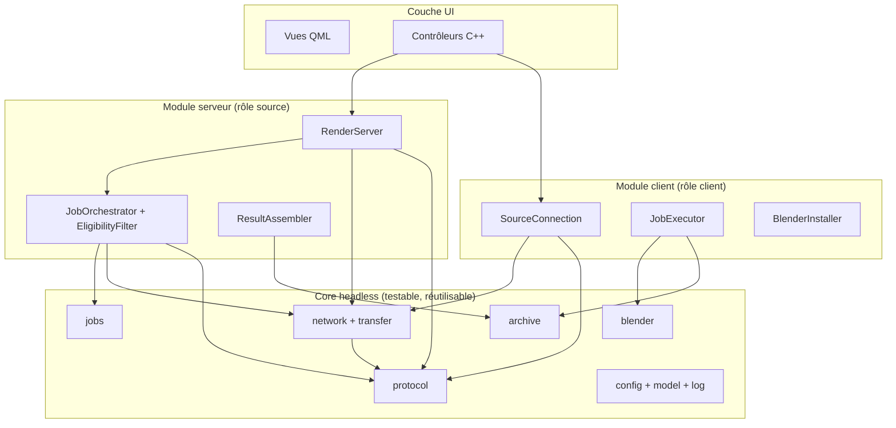
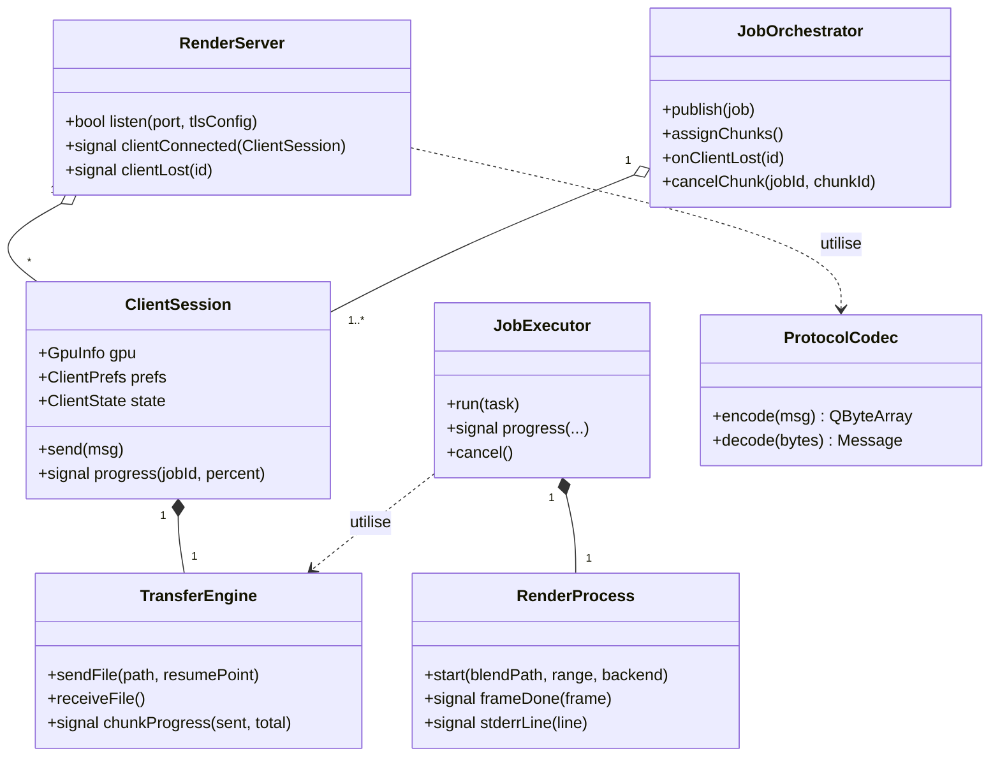

## Architecture du code

### 10 Principes directeurs

1. **Séparation stricte core / UI.** Toute la logique métier vit dans des bibliothèques **headless** (aucune dépendance à QML ni aux widgets) : pilotée par la couche QML en production, et directement pilotable par les tests automatisés et un outil CLI sans interface.
2. **Un seul binaire, deux rôles.** Les modules serveur (rôle source) et client cohabitent dans le même exécutable et sont activés selon l'action de l'utilisateur (cf. note d'architecture §2).
3. **Asynchronisme Qt avant threads manuels.** Réseau via signaux/slots (Qt Network est asynchrone par nature), rendus via `QProcess` asynchrone ; seuls les calculs lourds (SHA-256, zip) partent sur `QtConcurrent`.
4. **Le protocole isolé.** L'encodage/décodage des messages derrière une classe unique (`ProtocolCodec`) permet de simuler des clients dans les tests d'intégration sans Blender ni GPU.
5. **Cible CMake en couches** : les dépendances ne descendent jamais vers le haut (UI → rôles → core).

### 11 Arborescence du dépôt

```text
BlendNet/
├── CMakeLists.txt
├── cmake/                      helpers CMake, packaging (CPack)
├── src/
│   ├── main.cpp                point d'entrée unique (QApplication + chargement QML)
│   ├── core/                   bibliothèque headless, aucune dépendance UI
│   │   ├── protocol/           messages typés, sérialisation, framing, version
│   │   ├── network/            TLS (QSslSocket), écoute, reconnexion backoff
│   │   ├── transfer/           fichiers chunkés, SHA-256, reprise de transfert
│   │   ├── jobs/               Job, Chunk, FrameRange, scheduler, assemblage
│   │   ├── blender/            GpuInfo, versions, téléchargement, benchmark
│   │   ├── archive/            création/extraction ZIP sécurisée (RF-40, RNF-S4)
│   │   ├── config/             préférences, sources connues, token, réglages
│   │   ├── model/              ProjectInfo, ClientInfo, GpuInfo, Progress
│   │   └── log/                journalisation niveaux réglables (RNF-07)
│   ├── server/                 rôle source
│   │   ├── RenderServer        écoute TCP/TLS, accepte les connexions
│   │   ├── ClientSession       état d'un client (GPU_INFO, prefs, progression)
│   │   ├── JobOrchestrator     découpage en chunks, attribution, redistribution
│   │   ├── EligibilityFilter   filtrage RF-51 (moteurs, backend, dispo, VRAM)
│   │   └── ResultAssembler     vérification et assemblage de la séquence (RF-53)
│   ├── client/                 rôle client
│   │   ├── SourceConnection    connexion persistante, reconnexion (RF-10/11)
│   │   ├── JobExecutor         réception zip, dossier de travail, exécution
│   │   ├── RenderProcess       QProcess Blender + --cycles-device (RF-42)
│   │   └── BlenderInstaller    détection/téléchargement/checksum (RF-41)
│   └── ui/                     couche présentation
│       ├── qml/                Main, ProjectLibrary, JobView, ClientsTable,
│       │                       SharePopup, Settings, ClientJobs
│       └── controllers/        contrôleurs C++ exposés au QML
├── tests/
│   ├── unit/                   protocole, chunks, zip, éligibilité
│   ├── integration/            serveur + N clients simulés headless
│   └── protocol-fuzz/          trames malformées (robustesse réseau)
├── tools/
│   └── BlendNet-cli          client simulé pour tests réseau et démos
└── packaging/                  .deb / .rpm / AppImage / .exe / .dmg
```

**Cibles CMake :** `BlendNet-core` (lib statique) → `BlendNet-server` et `BlendNet-client` (libs) → `BlendNet-ui` (lib QML) → `BlendNet` (exécutable) ; `BlendNet-cli` et les tests ne dépendent que de `core` + `server`/`client`.

### 12 Diagramme des modules



### 13 Classes clés



| Classe | Responsabilité | Référence |
|---|---|---|
| `ProtocolCodec` | Encodage/décodage de tous les messages, framing, version | §5.2 |
| `RenderServer` | Écoute TLS, cycle de vie des sessions | RF-30, RNF-S1 |
| `ClientSession` | État d'un client connecté + progression | RF-12, RF-30 |
| `JobOrchestrator` | Découpage, attribution, redistribution | RF-50 à RF-52 |
| `EligibilityFilter` | Filtrage avant attribution | RF-51 |
| `ResultAssembler` | Complétude, intégrité, assemblage final | RF-53 |
| `TransferEngine` | Transfert chunké, SHA-256, reprise | §5.2, RNF-04 |
| `SourceConnection` | Connexion persistante + backoff | RF-10, RF-11 |
| `JobExecutor` | Job complet côté client : zip → rendu → renvoi | RF-40, RF-43 |
| `BlenderInstaller` | Détection/téléchargement vérifié de Blender | RF-41, RNF-S5 |
| `RenderProcess` | Lancement Blender CLI, `--cycles-device`, progression | RF-42, RF-25 |
| `GpuInfoService` | Détection GPU + benchmark optionnel | RF-12 |
| `NotificationService` | Popup + notification système | RF-13 |

### 14 Modèle de threads

- **Thread principal** : boucle d'événements Qt + UI QML. Tout le réseau (Qt Network) y vit via signaux/slots asynchrones — pas d'attente bloquante (RNF-05).
- **Rendus** : chaque `RenderProcess` lance Blender via `QProcess` (process séparé, non bloquant) ; la progression est parsée depuis stdout/stderr et remontée par signal → `PROGRESS`.
- **Calculs lourds** : SHA-256, compression/décompression ZIP via `QtConcurrent` / `QThreadPool`, jamais dans le thread UI.
- **Écriture disque** : les réceptions de fichiers (zip de plusieurs Go) écrivent en flux dans le dossier de travail, sans tout charger en mémoire (RNF-02).

### 15 Frontière QML

Les contrôleurs sont enregistrés comme types QML et exposent des `QAbstractListModel` (liste des projets, liste des clients) aux vues :

- `ProjectLibraryController` — bibliothèque de projets (RF-01 à RF-03)
- `JobController` — paramètres du job, publication, progression globale (RF-04, RF-05, RF-32)
- `ClientsController` — tableau des clients connectés, actions (RF-30, RF-31)
- `SettingsController` — sources connues, token, préférences (RF-10, RF-20 à RF-25)
- `ClientJobController` — vue client : tâche courante, participation, annulation (§6.4)
- `SharePopupController` — logique du popup Accepter/Refuser (RF-13)

> **Règle :** aucun des contrôleurs ne contient de logique métier — ils ne font que traduire les signaux du `core` en propriétés QML et les actions QML en appels vers `server`/`client`.