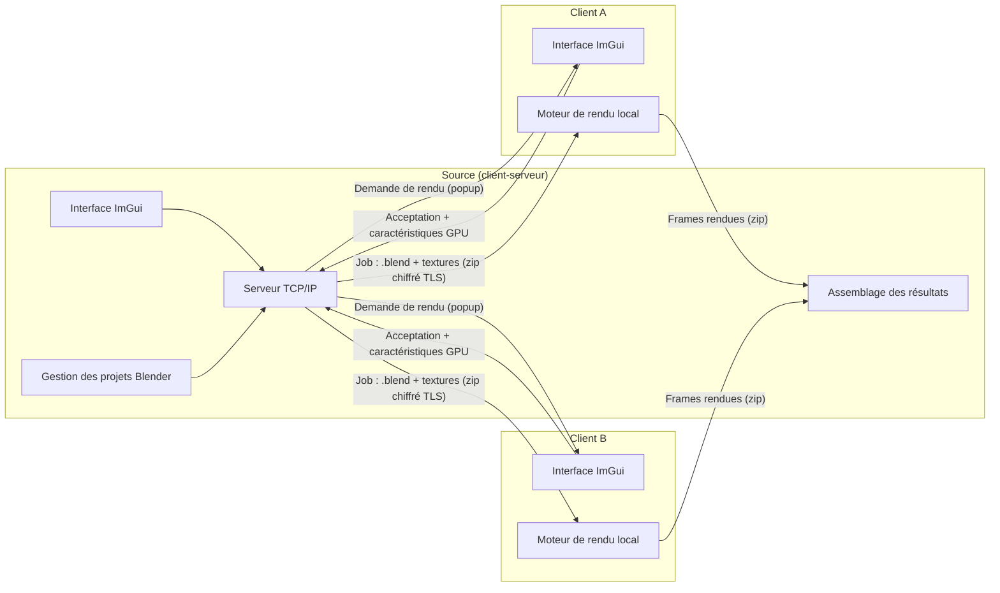
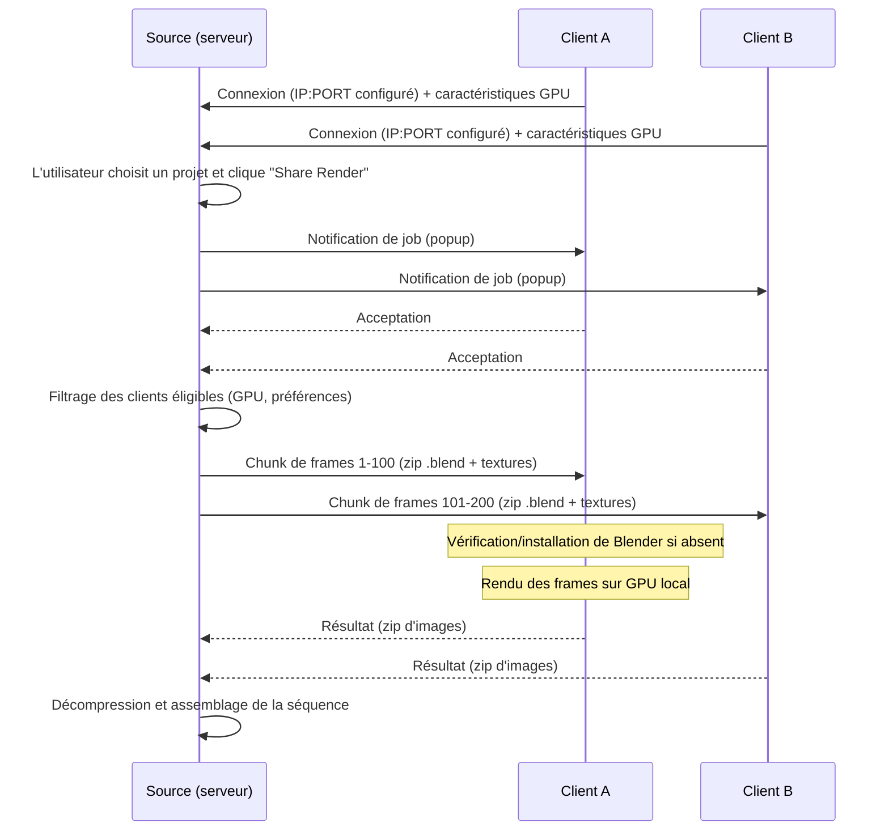
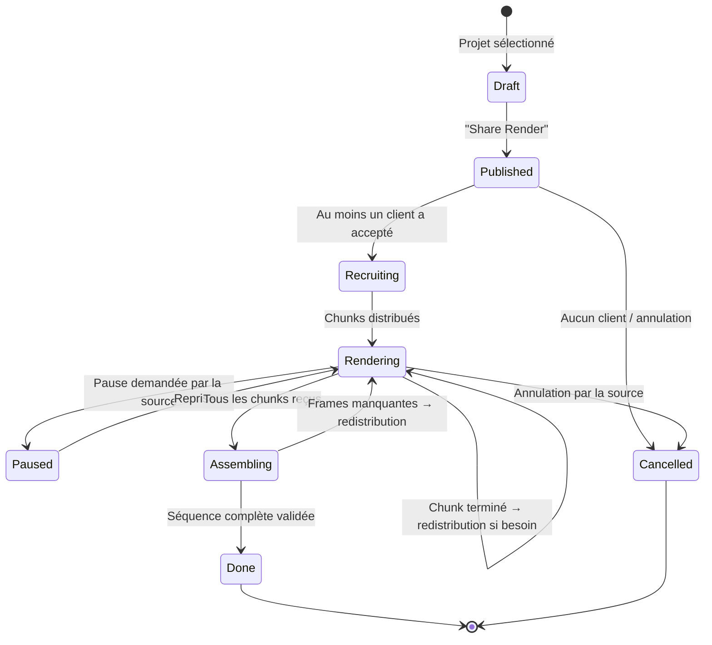
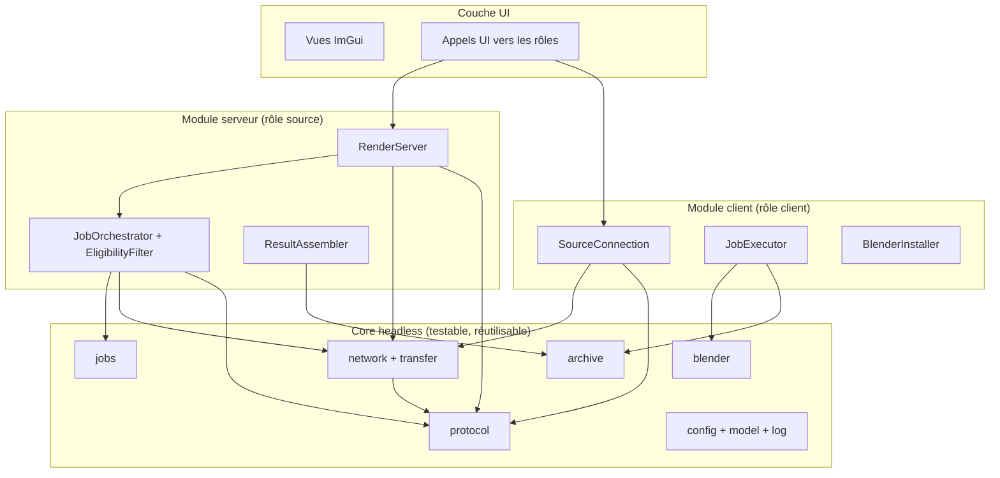
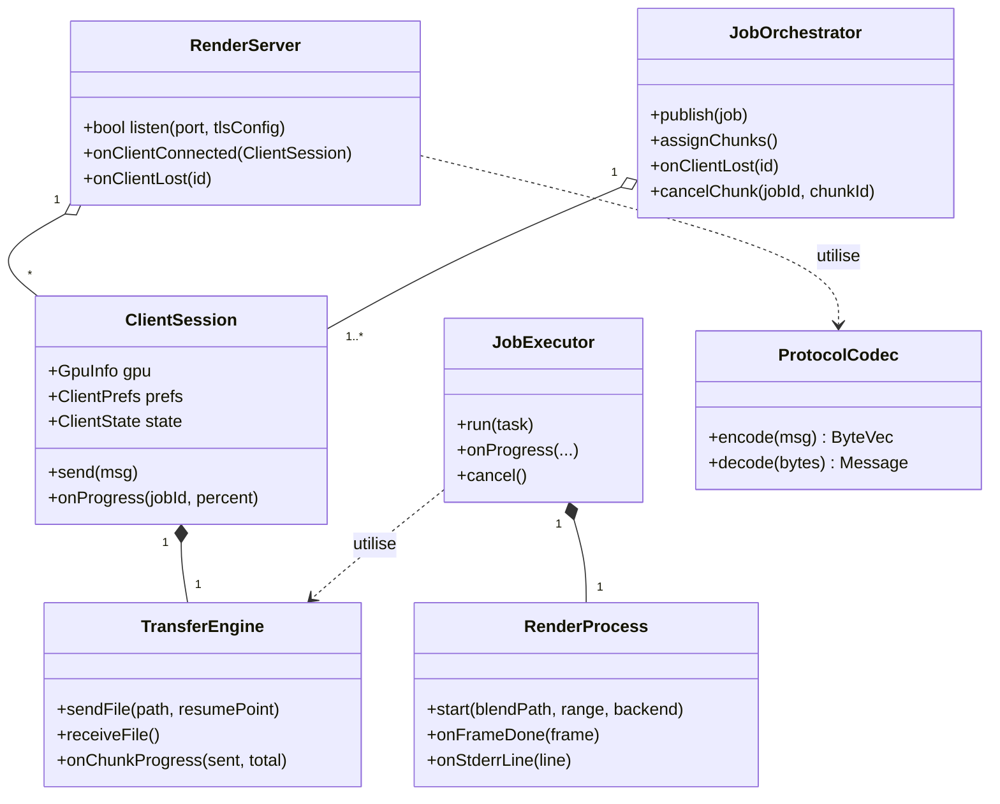

# Cahier des charges — BlendNet

### Application de rendu Blender distribué entre pairs

**Version :** 1.2 (passage de Qt/QML à Dear ImGui ; renommage BlendNet)  
**Statut :** Document de référence pour le développement  
**Licence cible :** Open source, GPL v3 ou ultérieure (compatible avec la licence de Blender, qui est GPL v2+)

---

## 1. Présentation du projet

### 1.1 Contexte

Le rendu d'animations ou de scènes complexes sous Blender est une opération très coûteuse en ressources GPU. Un seul poste de travail peut mettre plusieurs heures, voire plusieurs jours, à rendre une animation longue. BlendNet permet d'exploiter la puissance GPU de plusieurs ordinateurs d'amis, de collègues ou d'une communauté pour accélérer ces rendus.

### 1.2 Objectif

Développer une application de bureau multiplateforme (Linux, Windows, macOS) qui permet de **distribuer un rendu Blender sur plusieurs machines** via Internet :

- un utilisateur, appelé **source**, publie une demande de rendu depuis l'un de ses projets Blender ;
- les autres utilisateurs, appelés **clients**, reçoivent une notification et peuvent accepter de prêter leur GPU ;
- le rendu est découpé en **frames** distribuées entre les clients ;
- chaque client renvoie ses frames rendues à la source, qui assemble le résultat final.

### 1.3 Périmètre retenu


| Décision              | Choix                                                                                                             |
| --------------------- | ----------------------------------------------------------------------------------------------------------------- |
| Réseau                | **Internet uniquement** (aucune découverte LAN)                                                                   |
| Connexion client      | **Configuration manuelle** : l'utilisateur client saisit l'adresse IP et le port de la source dans les paramètres |
| Modèle économique     | **Open source** (GPL v3+)                                                                                         |
| Langage               | **C++** (C++20 recommandé)                                                                                        |
| Interface graphique   | **Dear ImGui** + GLFW + OpenGL 3.3                                                                                |
| Plateformes           | **Linux, Windows, macOS**                                                                                         |
| Périmètre du document | Cahier des charges **complet**, sans priorisation MVP                                                             |


---

## 2. Terminologie et rôles


| Terme             | Définition                                                                                                                                                                                                                                                                       |
| ----------------- | -------------------------------------------------------------------------------------------------------------------------------------------------------------------------------------------------------------------------------------------------------------------------------- |
| **Source**        | Utilisateur à l'origine d'une demande de rendu. La source joue à la fois le rôle de **serveur** (écoute TCP/IP, distribution des tâches, réception des résultats) et de **client applicatif** (interface ImGui, gestion de projets). C'est un modèle **client-serveur hybride**. |
| **Client**        | Utilisateur qui accepte de prêter son GPU pour exécuter tout ou partie d'un rendu demandé par une source.                                                                                                                                                                        |
| **Serveur**       | Le rôle réseau de la source : processus en écoute sur un port TCP/IP, qui gère les connexions clients, envoie les fichiers et collecte les résultats.                                                                                                                            |
| **Job**           | Un rendu demandé par une source (un projet Blender + paramètres : moteur, plage de frames, format de sortie, etc.).                                                                                                                                                              |
| **Tâche (chunk)** | Un lot de frames d'un job, attribué à un client donné.                                                                                                                                                                                                                           |
| **Frame**         | Une image individuelle de l'animation à rendre.                                                                                                                                                                                                                                  |


> **Note d'architecture :** la même application binaire joue le rôle de source ou de client selon l'action de l'utilisateur. Le rôle de serveur est activé côté source quand un job est publié ; le rôle de client est activé quand l'utilisateur accepte une demande.

---

## 3. Architecture générale

### 3.1 Vue d'ensemble



### 3.2 Flux nominal complet



---

## 4. Exigences fonctionnelles

Les exigences sont numérotées pour pouvoir s'y référer pendant le développement. Chaque exigence pourra passer par les états : *à faire → en cours → testé → validé*.

### 4.1 Gestion des projets Blender (côté source)

- **RF-01 — Bibliothèque de projets.** L'application affiche la liste de tous les projets Blender de l'utilisateur. La liste indique au minimum : nom du projet, chemin du fichier `.blend`, date de dernière modification.
- **RF-02 — Détail d'un projet.** Un clic sur un projet affiche ses informations : moteur de rendu (EEVEE / Cycles), nombre total de frames, résolution de sortie, format de sortie (PNG, JPEG, EXR, etc.), présence de textures liées, estimation indicative du poids des fichiers à transférer.
- **RF-03 — Ajout / retrait de projets.** L'utilisateur peut ajouter un dossier de projets à scanner et retirer des projets de la liste.
- **RF-04 — Paramètres du job.** Avant de lancer le partage, la source peut ajuster : la plage de frames à rendre (début/fin/pas), le moteur de rendu si différent de celui enregistré, la taille des chunks (nombre de frames par tâche). La sortie est toujours une **séquence d'images** (PNG, JPEG, EXR, etc.) — pas de rendu vidéo direct (décision n°6, §9).
- **RF-05 — Bouton "Share Render".** Déclenche la publication du job : notification envoyée à tous les clients connectés, puis, pour ceux qui acceptent, l'envoi des fichiers et la distribution des chunks.

### 4.2 Connexion et inscription des clients

- **RF-10 — Configuration manuelle.** Dans les paramètres, le client saisit l'adresse IP (ou nom de domaine) et le port de la source auxquels il veut se connecter. Il peut enregistrer plusieurs sources connues.
- **RF-11 — Connexion persistante.** Le client se connecte au serveur de la source et reste connecté (reconnexion automatique en cas de coupure réseau, avec backoff exponentiel).
- **RF-12 — Envoi des caractéristiques GPU.** Lors de la première connexion, le client envoie au serveur : modèle de GPU, VRAM disponible, quantité de RAM, système d'exploitation, version de Blender installée (ou absence de Blender), le **backend de calcul choisi dans ses paramètres** (OptiX, CUDA, HIP, oneAPI, Metal ou CPU, voir RF-25) et sa puissance indicative. **Benchmark optionnel** : au premier lancement, l'application propose au client d'exécuter un benchmark Blender (scène de référence) ; s'il accepte, le score est **sauvegardé dans sa configuration locale** et envoyé au serveur à chaque connexion. Le client peut refuser ou relancer le benchmark plus tard sans pénalité.
- **RF-13 — Notification de job.** À la réception d'une demande de rendu, chaque client connecté voit apparaître une fenêtre popup (même application réduite → notification système + popup) : nom du projet, moteur de rendu, nombre de frames, estimation de charge, boutons **Accepter** / **Refuser**.
- **RF-14 — Refus sans sanction.** Un refus n'entraîne aucune pénalité ; le client reçoit les prochains jobs normalement.

### 4.3 Paramètres du client

- **RF-20 — Préférences de moteurs de rendu.** Le client peut exclure des moteurs de rendu (par exemple : "aucun rendu EEVEE"). Le serveur ne lui attribue pas de tâches pour ces moteurs.
- **RF-21 — État de disponibilité.** Le client peut déclarer des états de disponibilité : *Disponible*, *Occupé — GPU en jeu*, *Occupé — au travail*, *Ne pas déranger*, *Hors ligne*. Le serveur en tient compte et n'envoie pas de popup aux clients indisponibles.
- **RF-22 — Plages horaires.** Le client peut définir des plages horaires de disponibilité (par exemple : seulement la nuit).
- **RF-23 — Limites de ressources.** Le client peut fixer des limites : nombre maximum de frames par job, utilisation GPU exclusive ou en arrière-plan, arrêt automatique du rendu si l'ordinateur est utilisé.
- **RF-24 — Emplacements de travail.** Le client choisit le dossier de téléchargement des jobs, le dossier de cache Blender, et peut définir un quota disque maximum.
- **RF-25 — Sélection du backend de calcul.** Dans ses paramètres, le client choisit le backend utilisé pour ses rendus : **OptiX, CUDA, HIP, oneAPI, Metal ou CPU**. Seuls les backends disponibles sur sa machine sont proposés. Ce choix est communiqué au serveur à la connexion (RF-12) et appliqué au lancement du rendu via l'option ligne de commande `--cycles-device <BACKEND>` (RF-42).

### 4.4 Gestion des clients (côté serveur/source)

- **RF-30 — Liste des clients connectés.** Le serveur affiche en temps réel : nom d'utilisateur, machine, GPU, backend de calcul (RF-25), état (*en attente*, *téléchargement*, *en cours de rendu*, *renvoi des résultats*, *inactif*), progression de sa tâche (frames faites / total).
- **RF-31 — Actions sur les clients.** Le serveur peut : déconnecter un client, annuler sa tâche en cours (avec redistribution des frames non rendues), exclure un client du job courant.
- **RF-32 — Barre de progression globale.** Vue du job : progression totale (frames rendues / total), vitesse moyenne, estimation du temps restant, répartition des chunks entre clients.
- **RF-33 — Journaux.** Journal des événements serveur (connexions, déconnexions, erreurs de transfert, rendus terminés), exportable.

### 4.5 Exécution du rendu (côté client)

- **RF-40 — Réception du job.** Le client reçoit un fichier ZIP contenant le fichier `.blend` et **toutes les dépendances** du projet (textures, HDRI, caches de simulation, fichiers liés). Il le décompresse dans son dossier de travail dédié, en préservant les chemins relatifs du projet.
- **RF-41 — Téléchargement automatique de Blender.** Si Blender est absent (ou si la version diffère de celle requise par le job), le client télécharge automatiquement la bonne version de Blender depuis blender.org (version exacte spécifiée dans le job). Le téléchargement est vérifié (checksum) avant exécution.
- **RF-42 — Exécution du rendu.** Le rendu est lancé en **headless** via l'interface en ligne de commande de Blender (`blender -b scene.blend -f 1-100`), avec l'addon inclus ou les paramètres du job appliqués par script (moteur, plage de frames, format, chemin de sortie). Le rendu utilise le **backend choisi par le client dans ses paramètres** (RF-25), appliqué via l'option ligne de commande `--cycles-device <BACKEND>` (par exemple `--cycles-device METAL`).
- **RF-43 — Renvoi des résultats.** À la fin de sa tâche, le client compresse les images rendues dans un ZIP et l'envoie au serveur. En cas d'échec partiel (certaines frames en erreur), il renvoie les frames valides et un rapport d'erreurs.
- **RF-44 — Nettoyage.** Après confirmation de réception par le serveur, le client supprime le job de son disque (selon sa préférence de rétention).

### 4.6 Distribution et assemblage (côté serveur)

- **RF-50 — Découpage en chunks.** Le job est divisé en lots de frames (taille paramétrable, défaut par exemple 20 frames). Le fichier projet ZIP est envoyé une fois par client ; seuls les numéros de frames diffèrent ensuite.
- **RF-51 — Éligibilité des clients.** Le serveur ne distribue pas de chunk à un client si : le client a refusé, le moteur de rendu est exclu par ses préférences, son GPU est jugé insuffisant (VRAM insuffisante pour la scène), il est indisponible, ou il n'a pas répondu au popup.
- **RF-52 — Redistribution automatique.** Si un client se déconnecte ou échoue sur un chunk, ses frames non rendues sont automatiquement réattribuées à un autre client (ou à la source elle-même en dernier recours).
- **RF-53 — Assemblage final.** Le serveur décompresse les ZIP reçus, vérifie l'intégrité et la complétude de la séquence (toutes les frames présentes, dimensions cohérentes), signale les frames manquantes ou corrompues, et organise la séquence finale dans le dossier de sortie du projet.
- **RF-54 — Pause / annulation.** La source peut mettre le job en pause ou l'annuler ; les clients en sont informés et stoppent le rendu en cours.
- **RF-55 — Cohérence du rendu entre machines.** Avec la même version de Blender, le même fichier `.blend`, les mêmes paramètres et le même backend de calcul, les frames sont identiques d'une machine à l'autre. Le backend est **choisi par chaque client dans ses paramètres** (RF-25) et déclaré au serveur (RF-12). La source voit le backend de chaque client connecté (RF-30) et peut, si elle souhaite une homogénéité parfaite de la séquence, limiter la distribution aux clients utilisant le backend de son choix ; aucun backend n'est imposé par le job.

---

## 5. Exigences techniques

### 5.1 Pile technologique


| Domaine        | Choix                                                                                     | Justification                                          |
| -------------- | ----------------------------------------------------------------------------------------- | ------------------------------------------------------ |
| Langage        | C++20                                                                                     | Modules, coroutines utiles pour l'asynchronisme réseau |
| GUI            | **Dear ImGui** (+ GLFW + OpenGL 3.3)                                                      | Interface outil légère, zéro moc, build simple         |
| Build          | CMake                                                                                     | Standard multiplateforme, packaging                    |
| Réseau         | TCP/IP via **Asio** (standalone ou Boost) + OpenSSL                                       | Sockets asynchrones, cross-platform                    |
| Chiffrement    | **OpenSSL** natif (TLS 1.2 minimum, 1.3 recommandé)                                       | Transferts sécurisés obligatoires                      |
| Compression    | libzip (ZIP) pour le stockage local, **zstd en option** pour le transport réseau          | Format ZIP demandé + compression rapide                |
| Sérialisation  | JSON (**nlohmann/json**)                                                                  | Messages de protocole lisibles et débogables           |
| Détection GPU  | NVML (NVIDIA), bibliothèques AMD/Intel + benchmark Blender optionnel au premier lancement | Informations GPU du client                             |
| Téléchargement | **libcurl** (uniquement pour blender.org)                                                 | Téléchargement automatique de Blender                  |
| Process        | **reproc** (sous-processus multiplateforme)                                               | Lancement de Blender headless                          |
| Tests          | Catch2 / GoogleTest + CI (GitHub Actions : Linux, Windows, macOS)                         | Qualité multiplateforme                                |
| Fenêtrage      | **GLFW** (fenêtres, entrées clavier/souris)                                               | Backend standard de Dear ImGui                         |
| Configuration  | Fichier **JSON** (`settings.json` via nlohmann/json)                                      | Préférences, sources connues, token                    |
| Threads        | `std::jthread` + **files de messages thread-safe**                                        | Communication réseau/rendus → UI                       |


### 5.2 Protocole applicatif

Toutes les communications passent par **TCP/IP sécurisé (TLS 1.2 minimum, TLS 1.3 recommandé)**. Le protocole applicatif définit des messages typés au-dessus de TLS :


| Phase          | Message                                                                              | Sens             |
| -------------- | ------------------------------------------------------------------------------------ | ---------------- |
| Connexion      | `HELLO` (version protocole, nom utilisateur, machine)                                | Client → Serveur |
| Enregistrement | `GPU_INFO` (modèle, VRAM, RAM, OS, version Blender, backend choisi, score benchmark) | Client → Serveur |
| Enregistrement | `CLIENT_PREFS` (moteurs exclus, disponibilité, limites)                              | Client → Serveur |
| Keep-alive     | `PING` / `PONG` (intervalle 10 s, timeout 30 s)                                      | Bidirectionnel   |
| Job            | `JOB_OFFER` (id job, projet, moteur, nb frames, taille estimée)                      | Serveur → Client |
| Job            | `JOB_ACCEPT` / `JOB_DECLINE`                                                         | Client → Serveur |
| Job            | `JOB_FILE` (zip projet, chunké avec checksum SHA-256)                                | Serveur → Client |
| Job            | `TASK_ASSIGN` (plage de frames, paramètres de sortie)                                | Serveur → Client |
| Rendu          | `PROGRESS` (frame courante, %, ETA)                                                  | Client → Serveur |
| Rendu          | `RESULT_FILE` (zip images, chunké avec checksum SHA-256)                             | Client → Serveur |
| Contrôle       | `TASK_CANCEL`, `JOB_PAUSE`, `CLIENT_KICK`                                            | Serveur → Client |


Règles :

- Les fichiers volumineux sont transférés par blocs avec barre de progression, reprise sur interruption et vérification SHA-256.
- Un en-tête binaire simple (taille + type de message) ou un protocole textuel type-delimité précède chaque message.
- Versionnement du protocole dès la v1 (`HELLO` contient la version) pour anticiper les évolutions.

### 5.3 Sécurité

- **RNF-S1 — Chiffrement TLS** systématique de tous les échanges (fichiers projet, images, messages).
- **RNF-S2 — Authentification.** La source génère un **token d'invitation** (code d'appairage) communiqué hors application (par message, orally, etc.). Le client saisit IP:PORT **et** le token dans ses paramètres ; le serveur refuse les connexions sans token valide.
- **RNF-S3 — Certificat serveur auto-signé épinglé (pinning)** au premier appairage, pour empêcher les attaques de l'homme du milieu ensuite.
- **RNF-S4 — Cloisonnement des jobs.** Les fichiers reçus sont extraits dans un dossier de travail dédié ; les chemins du ZIP sont validés (protection contre les chemins traversants `../`).
- **RNF-S5 — Aucune exécution de code arbitraire.** Seul Blender téléchargé depuis blender.org et vérifié par checksum est exécuté.
- **RNF-S6 — Limitation de ressources** configurables côté client (le client garde toujours la priorité sur sa machine).

### 5.4 Exigences non fonctionnelles


| ID     | Exigence                                                                                                                                                                              |
| ------ | ------------------------------------------------------------------------------------------------------------------------------------------------------------------------------------- |
| RNF-01 | **Portabilité** : builds et tests sur Linux, Windows 10+, macOS 12+ (x86\_64 + Apple Silicon).                                                                                        |
| RNF-02 | **Performance** : le protocole ne doit pas être le goulot — un job de 10 Go doit saturer la bande passante disponible ; compression zstd optionnelle.                                 |
| RNF-03 | **Fiabilité** : aucune frame n'est perdue — tout échec de client entraîne une redistribution ; le job ne se termine qu'avec 100 % des frames valides (ou liste explicite des échecs). |
| RNF-04 | **Reprise** : reprise des transferts interrompus (fichiers et job) après coupure réseau ou redémarrage de l'application.                                                              |
| RNF-05 | **Réactivité UI** : les transferts et rendus s'exécutent dans des threads séparés ; l'interface ne gèle jamais.                                                                       |
| RNF-06 | **UX** : configuration minimale pour un client non technique (IP:PORT + token, accepter popup, c'est tout).                                                                           |
| RNF-07 | **Journalisation** : logs horodatés des deux côtés, niveau réglable, exportables pour le support.                                                                                     |
| RNF-08 | **Installation** : packages natifs (`.deb`/`.rpm`, `.exe`/MSIX, `.dmg`) et/ou version portable.                                                                                       |
| RNF-09 | **i18n** : interface en français et anglais dès la v1 (catalogues gettext ou tables de clés), extensible.                                                                             |


**Routage réseau (décision n°7).** La source doit être joignable depuis Internet : IP publique (fixe ou dynamique) et **redirection de port** configurée sur son routeur vers la machine source. L'application affiche l'IP publique détectée pour la communiquer aux clients, et le guide utilisateur documente la redirection de port. Aucun mode relais ni UPnP en v1.

---

## 6. Interfaces utilisateurs (description fonctionnelle)

### 6.1 Écran principal — rôle Source

- Volet gauche : bibliothèque des projets Blender (RF-01, RF-03).
- Volet central : détails du projet sélectionné (RF-02) + paramètres du job (RF-04).
- Bouton principal : **Share Render** (RF-05).
- Volet droit / onglet : tableau des clients connectés avec états et progression (RF-30, RF-31), progression globale du job (RF-32), journal (RF-33).

### 6.2 Popup de demande — rôle Client

- Popup compact avec notification système : projet, moteur, frames, taille estimée, durée indicative, boutons Accepter / Refuser / "Plus tard" (RF-13).
- Auto-dismiss configurable (par exemple 60 s sans réponse = refus implicite).
- **Note ImGui** : la notification système (application minimisée) n'est pas fournie par ImGui/GLFW — le popup applicatif est le mécanisme principal ; une notification OS (bibliothèque dédiée par plateforme) est optionnelle en v1.

### 6.3 Paramètres — rôle Client

- Sources connues : liste IP:PORT + token d'appairage (RF-10, RNF-S2).
- Moteurs exclus (RF-20), backend de calcul pour les rendus (RF-25), disponibilité et plages horaires (RF-21, RF-22), limites de ressources (RF-23), dossiers et quotas disque (RF-24), rétention des jobs (RF-44).

### 6.4 Vue rendu local — rôle Client

- Progression de la tâche courante, frames terminées, vitesse, bouton *Annuler ma participation*, vue des jobs terminés.

---

## 7. Diagramme d'état d'un job



---

## 8. Livrables

1. **Code source** du dépôt (C++/CMake) avec README, guide de build par plateforme.
2. **Binaires packagés** : Linux (.deb + .rpm + AppImage), Windows (.exe), macOS (.dmg x86\_64 + Apple Silicon).
3. **Spécification du protocole** en document dédié (détail binaire/octets de chaque message).
4. **Documentation utilisateur** : guide source, guide client, guide appairage (IP:PORT + token).
5. **Plan de tests** : tests unitaires (protocole, ZIP, distribution), tests d'intégration (serveur + N clients simulés), tests réseau dégradé (coupure en cours de transfert).

---

## 9. Décisions d'architecture (points tranchés)

Les sept questions ouvertes de la version 1.0 ont été tranchées ; les décisions 2 (interface) et 3 (réseau) ont été **révisées en v1.2** lors du passage de Qt à Dear ImGui. Les décisions sont intégrées au reste du document ; ce tableau sert de synthèse de référence.


| #   | Sujet                                                                                                    | Décision                                                                                                                                                                                                                                                                                                                               |
| --- | -------------------------------------------------------------------------------------------------------- | -------------------------------------------------------------------------------------------------------------------------------------------------------------------------------------------------------------------------------------------------------------------------------------------------------------------------------------- |
| 1   | EEVEE et Cycles GPU → frames rendues identiques entre machines différentes (police, version GPU, OIDN) ? | Frames identiques si même version de Blender, même fichier, mêmes paramètres et même backend. Le **backend de calcul est choisi par le client dans ses paramètres** (OptiX, CUDA, HIP, oneAPI, Metal ou CPU), déclaré au serveur et appliqué au rendu via l'option ligne de commande `--cycles-device <BACKEND>`. Voir RF-25 et RF-55. |
| 2   | Interface graphique : Qt ou autre ?                                                                      | **Dear ImGui** retenu (**v1.2, remplace QML**) : plus léger, pas de moc, pas de build QML, build CMake trivial. Backend GLFW + OpenGL 3.3.                                                                                                                                                                                             |
| 3   | Backend réseau ?                                                                                         | **Asio** (standalone ou Boost) + OpenSSL retenu (**v1.2**) — Qt Network abandonné en même temps que Qt.                                                                                                                                                                                                                                |
| 4   | Compression des transferts : ZIP simple ou ZIP + zstd au transport ?                                     | **ZIP pour le stockage local** (jobs et résultats), **zstd en option** pour accélérer les transferts réseau.                                                                                                                                                                                                                           |
| 5   | Score GPU : benchmark intégré au premier lancement ou simple déclaration du modèle ?                     | **Benchmark optionnel** : proposé au client au premier lancement, score sauvegardé dans sa configuration locale et envoyé au serveur. Voir RF-12.                                                                                                                                                                                      |
| 6   | Support des animations en vidéo seule vs image sequences ?                                               | **Séquences d'images uniquement** en v1 ; l'assemblage vidéo est hors périmètre. Voir RF-04.                                                                                                                                                                                                                                           |
| 7   | Upnp/routage : la source doit-elle avoir une IP publique / redirection de port ?                         | **IP publique + redirection de port** sur le routeur de la source ; aucun mode relais ni UPnP en v1. Voir §5.4 (routage réseau).                                                                                                                                                                                                       |


---

## 10. Architecture du code

### 10.1 Principes directeurs

1. **Séparation stricte core / UI.** Toute la logique métier vit dans des bibliothèques **headless** (aucune dépendance à ImGui, GLFW ou OpenGL) : pilotée par la couche ImGui en production, et directement pilotable par les tests automatisés et un outil CLI sans interface.
2. **Un seul binaire, deux rôles.** Les modules serveur (rôle source) et client cohabitent dans le même exécutable et sont activés selon l'action de l'utilisateur (cf. note d'architecture §2).
3. **Threads dédiés + files de messages.** Le réseau vit sur un thread Asio dédié ; l'UI ImGui consomme une file d'événements thread-safe à chaque frame ; rendus via `reproc` (process séparé, non bloquant) ; seuls les calculs lourds (SHA-256, zip) partent sur un pool de threads.
4. **Le protocole isolé.** L'encodage/décodage des messages derrière une classe unique (`ProtocolCodec`) permet de simuler des clients dans les tests d'intégration sans Blender ni GPU.
5. **Cible CMake en couches** : les dépendances ne descendent jamais vers le haut (UI → rôles → core).

### 10.2 Arborescence du dépôt

```text
blendnet/
├── CMakeLists.txt
├── cmake/                      helpers CMake, packaging (CPack)
├── src/
│   ├── main.cpp                point d'entrée unique (init GLFW/OpenGL/ImGui + boucle de rendu)
│   ├── core/                   bibliothèque headless, aucune dépendance UI
│   │   ├── protocol/           messages typés, sérialisation, framing, version
│   │   ├── network/            TLS (Asio + OpenSSL), écoute, reconnexion backoff
│   │   ├── transfer/           fichiers chunkés, SHA-256, reprise de transfert
│   │   ├── jobs/               Job, Chunk, FrameRange, scheduler, assemblage
│   │   ├── blender/            GpuInfo, versions, téléchargement, benchmark
│   │   ├── archive/            création/extraction ZIP sécurisée (RF-40, RNF-S4)
│   │   ├── config/             préférences, sources connues, token, réglages
│   │   ├── model/              ProjectInfo, ClientInfo, GpuInfo, Progress
│   │   └── log/                journalisation niveaux réglables (RNF-07)
│   ├── server/                 rôle source
│   │   ├── RenderServer        écoute TCP/TLS, accepte les connexions
│   │   ├── ClientSession       état d'un client (GPU_INFO, prefs, progression)
│   │   ├── JobOrchestrator     découpage en chunks, attribution, redistribution
│   │   ├── EligibilityFilter   filtrage RF-51 (moteurs, backend, dispo, VRAM)
│   │   └── ResultAssembler     vérification et assemblage de la séquence (RF-53)
│   ├── client/                 rôle client
│   │   ├── SourceConnection    connexion persistante, reconnexion (RF-10/11)
│   │   ├── JobExecutor         réception zip, dossier de travail, exécution
│   │   ├── RenderProcess       reproc Blender + --cycles-device (RF-42)
│   │   └── BlenderInstaller    détection/téléchargement/checksum (RF-41)
│   └── ui/                     couche présentation (Dear ImGui)
│       ├── imgui/              init GLFW/ImGui, thème, polices UTF-8, docking
│       └── views/              Main, ProjectLibrary, ProjectDetail, JobView,
│                               ClientsTable, SharePopup, Settings, ClientJobs
├── tests/
│   ├── unit/                   protocole, chunks, zip, éligibilité
│   ├── integration/            serveur + N clients simulés headless
│   └── protocol-fuzz/          trames malformées (robustesse réseau)
├── tools/
│   └── blendnet-cli             client simulé pour tests réseau et démos
└── packaging/                  .deb / .rpm / AppImage / .exe / .dmg
```

**Cibles CMake :** `blendnet-core` (lib statique) → `blendnet-server` et `blendnet-client` (libs) → `blendnet-ui` (lib ImGui) → `blendnet` (exécutable) ; `blendnet-cli` et les tests ne dépendent que de `core` + `server`/`client`.

### 10.3 Diagramme des modules



### 10.4 Classes clés




| Classe                | Responsabilité                                           | Référence     |
| --------------------- | -------------------------------------------------------- | ------------- |
| `ProtocolCodec`       | Encodage/décodage de tous les messages, framing, version | §5.2          |
| `RenderServer`        | Écoute TLS, cycle de vie des sessions                    | RF-30, RNF-S1 |
| `ClientSession`       | État d'un client connecté + progression                  | RF-12, RF-30  |
| `JobOrchestrator`     | Découpage, attribution, redistribution                   | RF-50 à RF-52 |
| `EligibilityFilter`   | Filtrage avant attribution                               | RF-51         |
| `ResultAssembler`     | Complétude, intégrité, assemblage final                  | RF-53         |
| `TransferEngine`      | Transfert chunké, SHA-256, reprise                       | §5.2, RNF-04  |
| `SourceConnection`    | Connexion persistante + backoff                          | RF-10, RF-11  |
| `JobExecutor`         | Job complet côté client : zip → rendu → renvoi           | RF-40, RF-43  |
| `BlenderInstaller`    | Détection/téléchargement vérifié de Blender              | RF-41, RNF-S5 |
| `RenderProcess`       | Lancement Blender CLI, `--cycles-device`, progression    | RF-42, RF-25  |
| `GpuInfoService`      | Détection GPU + benchmark optionnel                      | RF-12         |
| `NotificationService` | Popup + notification système                             | RF-13         |


### 10.5 Modèle de threads

- **Thread UI (principal)** : boucle GLFW/ImGui (\~60 fps). Elle ne fait **aucun I/O bloquant** : à chaque frame elle consomme une file d'événements thread-safe remplie par les autres threads (RNF-05).
- **Thread réseau** : un `asio::io_context` dédié (serveur ou connexion client) ; les messages reçus/à envoyer transitent par des files thread-safe.
- **Rendus** : chaque `RenderProcess` lance Blender via `reproc` (process séparé, non bloquant) ; la progression est parsée depuis stdout/stderr et publiée dans la file d'événements → `PROGRESS`.
- **Pool de threads** : SHA-256, compression/décompression ZIP — jamais dans le thread UI.
- **Écriture disque** : les réceptions de fichiers (zip de plusieurs Go) écrivent en flux dans le dossier de travail, sans tout charger en mémoire (RNF-02).

### 10.6 Frontière UI (Dear ImGui)

Les vues ImGui appellent directement les modules `server`/`client` pour les actions, et lisent leurs états (projets, clients connectés, progression) via des snapshots rafraîchis depuis la file d'événements :

- `ProjectLibraryView` — bibliothèque de projets (RF-01 à RF-03)
- `ProjectDetailView` — détails du projet + paramètres du job + bouton **Share Render** (RF-02, RF-04, RF-05)
- `JobProgressView` — progression globale, vitesse, ETA (RF-32)
- `ClientsTableView` — tableau des clients connectés, actions (RF-30, RF-31)
- `SettingsView` — sources connues, token, préférences (RF-10, RF-20 à RF-25)
- `ClientJobsView` — vue client : tâche courante, participation, annulation (§6.4)
- `SharePopupView` — popup Accepter/Refuser (RF-13)

> **Règle :** aucune vue ne contient de logique métier — elles ne font que lire les états exposés par `core`/`server`/`client` et traduire les interactions utilisateur en appels vers `server`/`client`.

---

## 11. Glossaire

- **Chunk** : lot de frames attribué à un client.
- **Headless** : exécution de Blender sans interface graphique (`blender -b`).
- **TLS** : Transport Layer Security, chiffrement de la couche transport.
- **Token d'appairage** : code secret permettant à un client de s'authentifier auprès d'une source.
- **Pinning de certificat** : mémorisation du certificat du serveur au premier appairage pour éviter les attaques MITM.